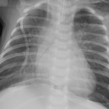
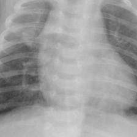

# S2-6datasets 示例题：三个模型对比

给做对比界面的同学。10 道题都来自公开测试集，**S2-6datasets 答对、原版和 S2-2datasets 都答错**。

- 原版 = `intern-s2-base`；S2-2datasets = `intern-s2-medlora`（世龙部署的那个）；S2-6datasets = `intern-s2-6ds`。
- 下面的回答是评测时记录的（关闭思考模式、temperature 0），用对比接口按同样的提问重问，答案应该一样或几乎一样。
- **提问请用「完整提问」的原文**，包括末尾那句回答要求。
- 这些题是**挑出来的**；整体成绩：S2-6datasets 在医学看图问答、「不确定」题、医学通用能力上与 S2-2datasets 持平，在病理图（PathVQA）、医师考试题（MedQA）、儿童胸片判断肺炎、描述胸片时不漏报这几项上明显更好。
- 批量重跑：`python scripts/compare_ask.py batch docs/compare_examples_6ds/examples.jsonl`

## 图文题（5 道）

### img1 · 胸片诊断：另外两个都说肺不张，S2-6datasets 答对肺炎

- 来源：SLAKE 测试集 qid 12050 (X-Ray)
- 图片（服务器）：`/home/ubuntu/chunqian/data/SLAKE/imgs/xmlab173/source.jpg`
- 完整提问：

```
What diseases are included in the picture?
Answer with a single word or short phrase.
```

- **正确答案**：Pneumonia

| 原版 | S2-2datasets | S2-6datasets |
|---|---|---|
| Atelectasis ❌ | Atelectasis ❌ | Pneumonia ✅ |

### img2 · MRI 定位：原版说右叶、S2-2datasets 说右上叶，S2-6datasets 答对左上叶

- 来源：SLAKE 测试集 qid 12654 (MRI)
- 图片（服务器）：`/home/ubuntu/chunqian/data/SLAKE/imgs/xmlab469/source.jpg`
- 完整提问：

```
Where are the abnormalities in this image?
Answer with a single word or short phrase.
```

- **正确答案**：Upper Left Lobe

| 原版 | S2-2datasets | S2-6datasets |
|---|---|---|
| Right lobe ❌ | Upper Right Lobe ❌ | Upper Left Lobe ✅ |

### img3 · CT 常识判断：另外两个都说有能运送食物的器官，S2-6datasets 答对「没有」

- 来源：SLAKE 测试集 qid 12925 (CT)
- 图片（服务器）：`/home/ubuntu/chunqian/data/SLAKE/imgs/xmlab622/source.jpg`
- 完整提问：

```
Are there organs in the picture that can deliver food?
Answer with yes or no only.
```

- **正确答案**：No

| 原版 | S2-2datasets | S2-6datasets |
|---|---|---|
| Yes ❌ | Yes ❌ | No ✅ |

### img4 · 儿童胸片判断肺炎：另外两个都说没有，S2-6datasets 答对「有」

- 来源：PneumoniaMNIST 测试集第 92 张 (儿童胸片, 标签: 肺炎)
- 图片（服务器）：`/home/ubuntu/chunqian/MedLoRA/docs/compare_examples_6ds/images/pneumoniamnist_test_92.png`


- 完整提问：

```
Does this chest X-ray show pneumonia?
Answer with yes or no only.
```

- **正确答案**：yes

| 原版 | S2-2datasets | S2-6datasets |
|---|---|---|
| No, it shows no signs of pneumonia ❌ | No ❌ | yes ✅ |

### img5 · 儿童胸片描述：另外两个都写肺野清晰，S2-6datasets 说出右肺有实变

- 来源：PneumoniaMNIST 测试集第 105 张 (儿童胸片, 标签: 肺炎)
- 图片（服务器）：`/home/ubuntu/chunqian/MedLoRA/docs/compare_examples_6ds/images/pneumoniamnist_test_105.png`


- 完整提问：

```
Describe this chest X-ray in two or three sentences, including any abnormal findings.
```

- **正确答案**：（应指出肺部有异常 / 肺炎）

**原版** ❌

> This chest X-ray shows a clear and well-defined lung field with no visible signs of abnormalities such as infiltrates, consolidations, or ground-glass opacities. The heart and diaphragm appear normal, and the bony structures are intact without any fractures or lesions.

**S2-2datasets** ❌

> This chest X-ray shows the thoracic cavity with the heart centrally located. The heart appears enlarged, occupying more space than usual, which is indicative of cardiomegaly. The lung fields are visible on either side of the heart, and the ribs are clearly outlined.

**S2-6datasets** ✅

> This chest X-ray reveals a notable opacity in the right lung field, suggesting the presence of lung consolidation. The affected area appears denser compared to the surrounding lung tissue, indicating a possible infection or fluid accumulation. The heart and diaphragm appear normal, with no evident abnormalities in the left lung field.

## 纯文字题（5 道）

PubMedQA 题先给一段论文摘要（Context），再问问题，要整段一起复制去问。

### txt1 · 证据不足时敢说「不确定」：另外两个都给了肯定答案

- 来源：PubMedQA 考卷半边 pubid 23360491
- 问题：*Is the processing of affective prosody influenced by spatial attention?*
- 完整提问：

```
You are a biomedical research assistant.
Context:
The present study asked whether the processing of affective prosody is modulated by spatial attention. Pseudo-words with a neutral, happy, threatening, and fearful prosody were presented at two spatial positions. Participants attended to one position in order to detect infrequent targets. Emotional prosody was task irrelevant. The electro-encephalogram (EEG) was recorded to assess processing differences as a function of spatial attention and emotional valence.
Event-related potentials (ERPs) differed as a function of emotional prosody both when attended and when unattended. While emotional prosody effects interacted with effects of spatial attention at early processing levels (<200 ms), these effects were additive at later processing stages (>200 ms).

Question: Is the processing of affective prosody influenced by spatial attention?
Based only on the context, answer with exactly one word: yes, no, or maybe.
```

- **正确答案**：maybe

| 原版 | S2-2datasets | S2-6datasets |
|---|---|---|
| yes ❌ | yes ❌ | maybe ✅ |

### txt2 · 证据不足时敢说「不确定」：另外两个都给了肯定答案

- 来源：PubMedQA 考卷半边 pubid 24434052
- 问题：*Are we seeing the effects of public awareness campaigns?*
- 完整提问：

```
You are a biomedical research assistant.
Context:
The last 20 years has seen a marked improvement in skin cancer awareness campaigns. We sought to establish whether this has affected the presenting Breslow thickness of malignant melanoma in the South West.
This is a retrospective study looking at the first presentation of melanomas from 2003 to 2011. Data was accessed using the local online melanoma database.
A total of 2001 new melanomas presented from 2003 to 2012 (Male:Female = 1:1.062). The average yearly number of melanomas was 200.1 (range = 138-312). The mean age was 62.5 years (range 12-99). Data was analysed using a Chi² test. For 0-1 mm melanomas, there is a significant difference in the observed versus expected values over the 10 years (p = 0.0018). There is an increasing proportion of 0-1 mm (thin) melanomas presenting year on year, with a positive linear trend. This is very statistically significant (p<0.0001). The 1-2 mm melanomas are decreasing in proportion with a negative linear trend (p = 0.0013). The 2-4 mm are also decreasing in proportion (p = 0.0253). There is no significant change in the thick>4 mm melanomas (p = 0.1456).

Question: Are we seeing the effects of public awareness campaigns?
Based only on the context, answer with exactly one word: yes, no, or maybe.
```

- **正确答案**：maybe

| 原版 | S2-2datasets | S2-6datasets |
|---|---|---|
| yes ❌ | yes ❌ | maybe ✅ |

### txt3 · 医师考试病例题：原版选 B、S2-2datasets 选 B，S2-6datasets 选对

- 来源：MedQA 测试集第 765 题
- 完整提问：

```
A 7-year-old boy is brought to your office with complaints of wheezing and dyspnea. Laboratory work reveals eosinophilia and positive skin tests for allergens. Which of the following types of drugs would be an effective treatment in this patient?
A. Beta-2 antagonist
B. Histone deacetylase inhibitor
C. Muscarinic antagonist
D. Anticoagulant
Answer with the option's letter from the given choices directly.
```

- **正确答案**：C. Muscarinic antagonist

| 原版 | S2-2datasets | S2-6datasets |
|---|---|---|
| B ❌ | B ❌ | C ✅ |

### txt4 · 医师考试病例题：原版选 B、S2-2datasets 选 B，S2-6datasets 选对

- 来源：MedQA 测试集第 1002 题
- 完整提问：

```
A previously healthy 28-year-old man comes to the emergency department because of dizziness and palpitations for 2 days. Prior to the onset of the symptoms, he attended a bachelor party where he lost several drinking games. An ECG is shown. Which of the following is the most likely diagnosis?
A. Paroxysmal atrial fibrillation
B. Brugada syndrome
C. Ventricular tachycardia
D. Sick sinus syndrome
Answer with the option's letter from the given choices directly.
```

- **正确答案**：A. Paroxysmal atrial fibrillation

| 原版 | S2-2datasets | S2-6datasets |
|---|---|---|
| B ❌ | B ❌ | A ✅ |

### txt5 · 医师考试病例题：原版选 C、S2-2datasets 选 C，S2-6datasets 选对

- 来源：MedQA 测试集第 939 题
- 完整提问：

```
A 32-year-old woman comes to the physician because of fatigue and joint pain for the past 4 months. Examination shows erythema with scaling on both cheeks that spares the nasolabial folds and two 1-cm ulcers in the oral cavity. Further evaluation of this patient is most likely to show which of the following findings?
A. Decreased lymphocyte count
B. Increased platelet count
C. Increased prothrombin time
D. Decreased gamma globulin
Answer with the option's letter from the given choices directly.
```

- **正确答案**：A. Decreased lymphocyte count

| 原版 | S2-2datasets | S2-6datasets |
|---|---|---|
| C ❌ | C ❌ | A ✅ |
